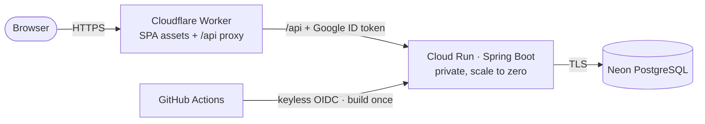

# fullstack-template

**A production-oriented full-stack template that runs on free-tier infrastructure (hard limit: $1/month), with cost safety designed into the architecture.**

React · Spring Boot · PostgreSQL · Docker · Terraform · GitHub Actions · Cloud Run · Cloudflare

> **Status:** foundations complete (M0). The application layers are being delivered milestone by milestone. See the [roadmap](docs/roadmap.md).

## Why this exists

Most starter templates stop at "hello world on localhost". This one aims to be a **realistic starting point for a real product**:

- authentication;
- tested database migrations;
- a build-once, promote-by-digest delivery pipeline;
- infrastructure as code;
- disaster-recovery drills;
- a hard cost ceiling.

Every significant decision is recorded as an ADR, with the alternatives that were rejected.

## Architecture



Read more: [architecture overview](docs/architecture/overview.md) · [decision records](docs/adr/README.md)

## Engineering highlights

| Area                           | Approach                                                                                                                                                                                                                                                                                                                    |
| ------------------------------ | --------------------------------------------------------------------------------------------------------------------------------------------------------------------------------------------------------------------------------------------------------------------------------------------------------------------------- |
| **Cost safety by design**      | The backend is **private**, reachable only through an edge proxy. That caps worst-case spend at a few dollars even under abuse, and a budget kill switch stops services at $0.50. Expected cost: about $0/month. ([ADR 0006](docs/adr/0006-private-backend-behind-edge-proxy.md), [0010](docs/adr/0010-cost-guardrails.md)) |
| **Contract-first API**         | OpenAPI is the source of truth, and the TypeScript client is generated from it. Frontend and backend can be developed in parallel without drift. ([ADR 0003](docs/adr/0003-contract-first-rest-api.md))                                                                                                                     |
| **Safe schema evolution**      | Flyway migrations are immutable and follow expand/contract. They run as a pre-deploy job under a separate least-privilege role. CI tests the previous release against the new schema. ([ADR 0007](docs/adr/0007-database-migrations.md))                                                                                    |
| **Secure authentication**      | A backend-for-frontend session model: Argon2id, Google OIDC with PKCE, `__Host-` cookies, rate limiting. No tokens in the browser. ([ADR 0004](docs/adr/0004-session-based-authentication.md))                                                                                                                              |
| **Delivery**                   | Build once, promote the same image digest from staging to prod. Zero-downtime revisions, automatic rollback, no long-lived CI credentials.                                                                                                                                                                                  |
| **Serverless-aware design**    | No in-process background work, an explicit cold-start strategy, and portable twelve-factor containers. ([ADR 0005](docs/adr/0005-serverless-hosting.md), [0008](docs/adr/0008-no-in-process-background-work.md))                                                                                                            |
| **Governed AI-agent workflow** | Specialist Claude Code agents with scoped responsibilities and an independent read-only reviewer. Critical rules are enforced by hooks, not prompts. ([agentic workflow](docs/engineering/agentic-workflow.md))                                                                                                             |
| **Reproducible environment**   | A Dev Container pins Java 25 LTS, Node 26 LTS and all tooling. One click to a working setup on any OS.                                                                                                                                                                                                                      |

## Tech stack

| Layer    | Technology                                                                            |
| -------- | ------------------------------------------------------------------------------------- |
| Frontend | React 19, TypeScript, Vite, Tailwind CSS v4, shadcn/ui, TanStack Query, React Router  |
| Edge     | Cloudflare Workers (static assets and API proxy)                                      |
| Backend  | Java 25, Spring Boot 4, Spring Security, Spring Data JPA, Spring Modulith             |
| Data     | PostgreSQL (Neon), Flyway                                                             |
| Testing  | JUnit 5, Mockito, Testcontainers, Vitest, React Testing Library, MSW, Playwright, axe |
| Delivery | Docker, Docker Compose, GitHub Actions, Terraform, Google Cloud Run                   |

## Getting started

**Prerequisites:** [Docker Desktop](https://www.docker.com/products/docker-desktop/) and [VS Code](https://code.visualstudio.com/) with the Dev Containers extension.

1. Clone the repository and open it in VS Code.
2. Run **Dev Containers: Reopen in Container**. Java, Node, pnpm and all CLIs are installed automatically.
3. Verify the setup:
   ```bash
   java -version     # 25
   node -v           # v26.x
   pnpm test:hooks
   ```

On Windows, **Dev Containers: Clone Repository in Container Volume** gives the best file-system performance. Backend, frontend and end-to-end commands arrive with milestones M1–M3.

## Repository layout

```text
backend/        Spring Boot application
frontend/       React SPA + Cloudflare edge Worker
e2e/            Playwright end-to-end tests
infra/          Dockerfiles, Compose, Terraform
docs/           Architecture, ADRs, engineering standards, runbooks
.claude/        AI-agent definitions, guard hooks, permissions
.devcontainer/  Reproducible development environment
.github/        CI/CD workflows, templates, Dependabot
```

## Documentation

- [Architecture overview](docs/architecture/overview.md) · [Decision records](docs/adr/README.md) · [Roadmap](docs/roadmap.md) · [Engineering log](docs/engineering-log.md)
- Standards: [coding](docs/engineering/coding-standards.md) · [testing](docs/engineering/testing-strategy.md) · [git workflow](docs/engineering/git-workflow.md) · [definition of done](docs/engineering/definition-of-done.md) · [agentic workflow](docs/engineering/agentic-workflow.md)
- [Runbooks](docs/runbooks/README.md) · [Contributing](CONTRIBUTING.md) · [Security policy](SECURITY.md)

## License

[MIT](LICENSE) © Mahbubur Rahman Mishal
