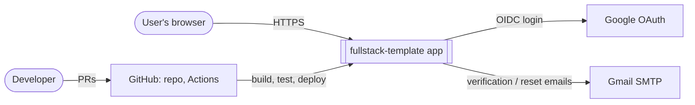
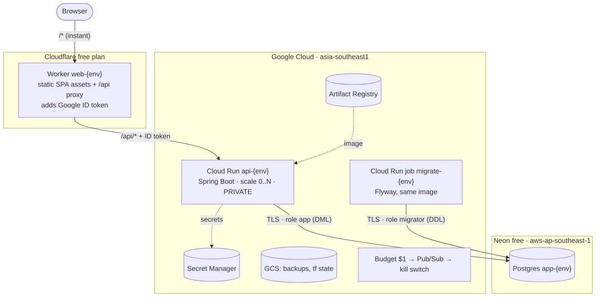

# Architecture overview

## 1. Goals and constraints

| Quality goal       | What it means here                                                                                                               |
| ------------------ | -------------------------------------------------------------------------------------------------------------------------------- |
| **Cost**           | Infrastructure cost is **≤ $1/month, with $0 as the target.** The service stops itself before the budget is exceeded (ADR 0010). |
| **Low operations** | No servers to patch. Managed, scale-to-zero services only (ADR 0005).                                                            |
| **Security**       | Session-based authentication, least privilege everywhere, no long-lived CI credentials (ADRs 0004, 0009).                        |
| **Portability**    | The app is a standard container. Moving cloud means changing Terraform, not app code (ADR 0005).                                 |
| **Traceability**   | Every significant choice is documented as an ADR with alternatives and consequences.                                             |

**Accepted trade-off:** the first request after about 15 minutes idle has a **cold start of a few seconds**. Pages themselves always load instantly from the edge.

## 2. System context



## 3. Containers (runtime building blocks)



| Container     | Technology                             | Responsibility                                                                                                                                           |
| ------------- | -------------------------------------- | -------------------------------------------------------------------------------------------------------------------------------------------------------- |
| Edge Worker   | Cloudflare Workers Static Assets       | Serves the SPA. Proxies `/api/*` so the API is same-origin (first-party cookies, no CORS). The only public entry point, so it also caps cost (ADR 0006). |
| API           | Spring Boot 4 on Java 25, on Cloud Run | REST API, authentication and sessions, business logic. A modular monolith (ADR 0002).                                                                    |
| Migration job | Same image, `migrate` profile          | Applies Flyway migrations before each deploy (ADR 0007).                                                                                                 |
| Database      | Neon Postgres                          | System of record, including HTTP sessions (Spring Session JDBC).                                                                                         |

## 4. Environments

|          | Local                               | Staging                             | Prod                       |
| -------- | ----------------------------------- | ----------------------------------- | -------------------------- |
| Frontend | Vite dev server (proxies `/api`)    | Worker `web-staging`                | Worker `web-prod`          |
| Backend  | `./mvnw spring-boot:run` or Compose | Cloud Run `api-staging` (0–1)       | Cloud Run `api-prod` (0–2) |
| Database | Compose Postgres / Testcontainers   | Neon `app-staging` (seed data only) | Neon `app-prod`            |
| Email    | Mailpit                             | Gmail SMTP                          | Gmail SMTP                 |
| Deploys  | –                                   | Automatic on merge                  | Manual approval            |

Each environment has its **own** secrets, service accounts, database and backups. Prod data never goes to staging.

## 5. Delivery pipeline (summary)

```text
PR ──► CI: build · unit/integration (Testcontainers) · component · E2E (Compose) · scans · N-1 migration test
merge to main ──► build image ONCE (@sha256) + SPA once
  ──► staging: migrate job → deploy revision (no traffic) → smoke → shift 100% → Worker deploy → E2E smoke
  ──► [manual approval] ──► prod: same digest, same steps
  any failure ──► automatic rollback (traffic back to previous revision; wrangler rollback)
```

The full design ships in M4 and M7.

## 6. Cross-cutting concepts

- **Authentication:** Spring Security as a backend-for-frontend. Username and password (Argon2id) plus Google OIDC. Sessions live in Postgres, in a `__Host-` HttpOnly cookie (ADR 0004).
- **API:** REST, contract-first OpenAPI. The TypeScript client is generated from the contract. Errors use RFC 9457 `ProblemDetail` (ADR 0003).
- **Scale to zero:** no background threads or schedulers in the app. Periodic work runs as scheduled jobs (ADR 0008).
- **Observability:** JSON logs to stdout, Actuator health probes, and correlation IDs from M8.
- **Cost guardrails:** Cloud Run is private behind the Worker, with max-instances caps and a 30 s timeout. Free plans that stop rather than bill. A budget kill switch (ADR 0010).

## 7. Decisions

See the [ADR index](../adr/README.md).
